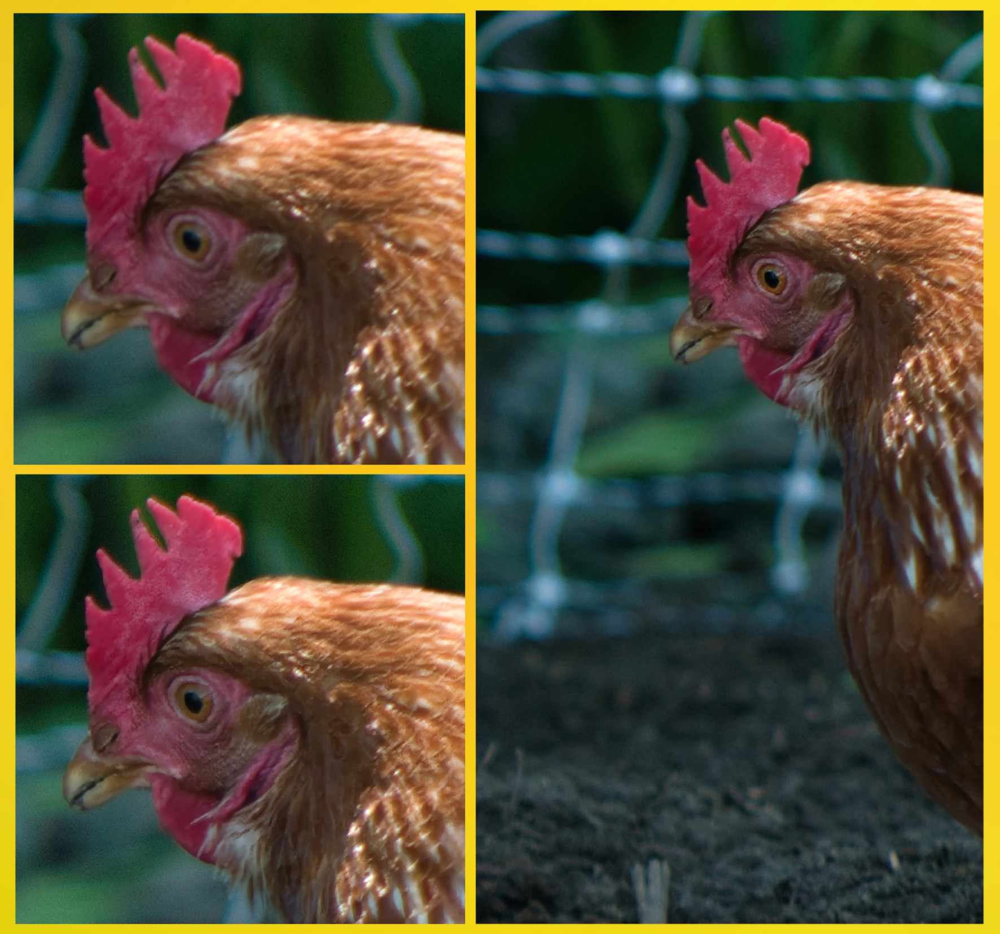
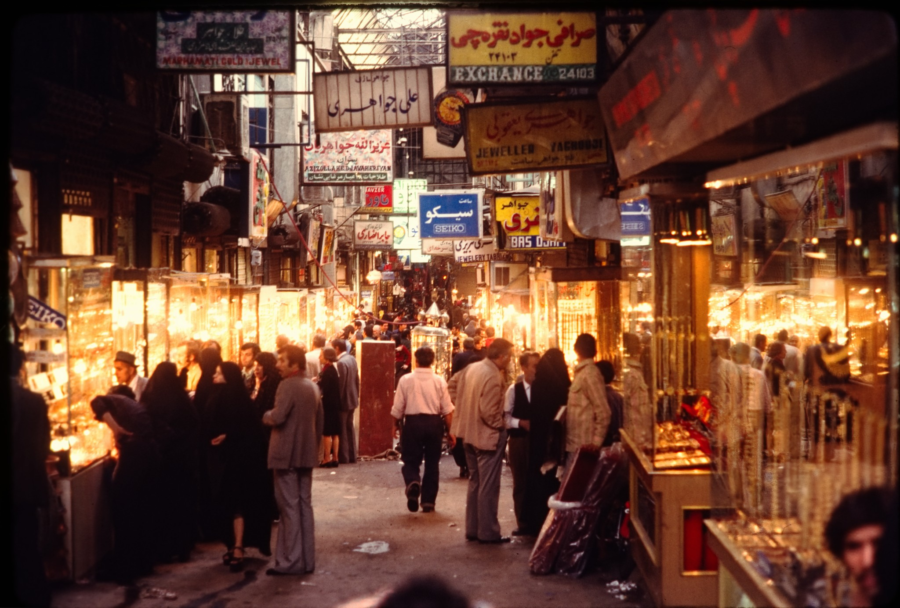
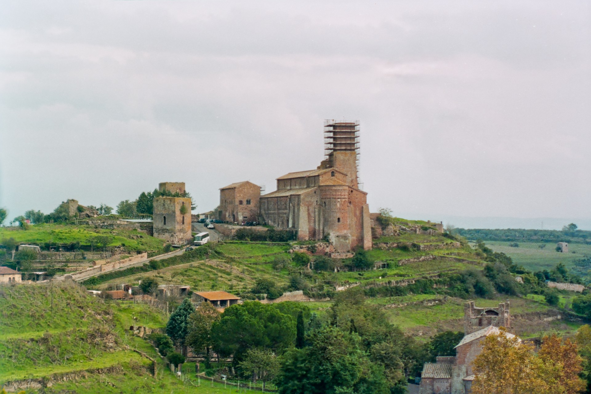

# Notes for photographers

*Written by the author of this fork, from his own photographs, October 2026. The typeset
original is [`assets/notes/notes-for-photographers.pdf`](assets/notes/notes-for-photographers.pdf);
this is the same text with its figures.*

---

## A portrait with motion and defocus blur

*Top left: original. Bottom left: deblurred. Right side: result.*

The top left below is a cutout portrait of my favourite chicken/escape artist. It was taken
with my 1957 Jupiter 9 85mm lens. Because she doesn't listen to me when I order her
'Stay Still' there is some motion and out of focus blur. No matter what I did and what type
of sharpening I did in Affinity it just didn't look natural.

I took the cutout of the head and ran it through the deblur program with the result (bottom
left) and then used Affinity to merge/blend the enhanced image into the original image with
the result on the right side. See the second image, it may not look like much, but
sometimes I need to elevate an important image without introducing fake AI artifacts.

## Deblurring vs. sharpening vs. AI enhancement

*The Grand Bazaar with a history of over 5 centuries, Iran (1977, the year the Eaton Centre
was opened) Kodak Kodachrome 64.*

Imagine a satellite trying to read a license plate on the ground. The satellite's motion
during the shot and the wavy atmosphere smear each letter into a fuzzy streak. Since you
don't know the exact smear, the software estimates the most likely kind of blur that could
have caused that fuzziness, reverses it, then adjusts its guess and tries again until the
letters come back into focus. The information is still there—just smeared—and deblurring
tries to un-smear it using its best guess.

This is different from sharpening, which just makes the fuzzy streaks look punchier, not
readable. And it's different from AI enhancing, which might guess a plausible license plate
number based on patterns it has seen—but could just as easily guess wrong. Deblurring tries
to recover what was actually there; the other two don't.

The image above was a deblur of the full sized image then the result was subsequently
merged with the original image to enhance the signs, the people and activity.

## Where it doesn't help

Sometimes, as in this case, due to a toy film camera your holiday shot turns out to be
useless. Using deblur on a social media sized crop can just maybe look good enough to post.

Also sometimes it can be used on a large sized image in place of sharpening. The result is
more organic than other methods. But this only works on some images. Apply IFAN to the full
size version of the image above results in too many artifacts. Trying to deblur structures
at full resolution on an image like the one above is a pointless task.

---

**Provenance.** The photographs here are the author's own. The hen was taken with a 1957
Jupiter 9 85 mm lens; the bazaar is a 1977 Kodak Kodachrome 64 slide, later digitised by
the author; the hill town is a 1970s toy-camera frame. They appear here as they do in the
typeset note.

**Licence.** The text of this note is © 2026 Ryan Raz and, like the additions to this
repository, under the AGPL-3.0. The photographs are not: **they are not covered by that
grant and are not licensed for reuse.**
